# achievement-lab

A practice repository. It holds small text files that exist only so that GitHub collaboration steps (branches, pull
requests, reviews, co-authored commits, merges) can be tried end to end without touching a real project. There is
no software to install or run here.

- [PURPOSE.md](PURPOSE.md): why the repository exists.
- [WORKFLOW.md](WORKFLOW.md): the steps each exercise follows.
- [COLLABORATION.md](COLLABORATION.md): how pull requests and reviews are done here.
- `achievements/` and `milestones/`: one small file per exercise.

## Practice a real review

Use a small documentation change to practise writing a clear pull request, giving actionable feedback and verifying a revision. [Follow the exercise](WORKFLOW.md). This sandbox does not award or promise achievements.

## Contributing

This is a personal sandbox, so outside pull requests are not expected. Questions go to [issues](../../issues/new/choose).
